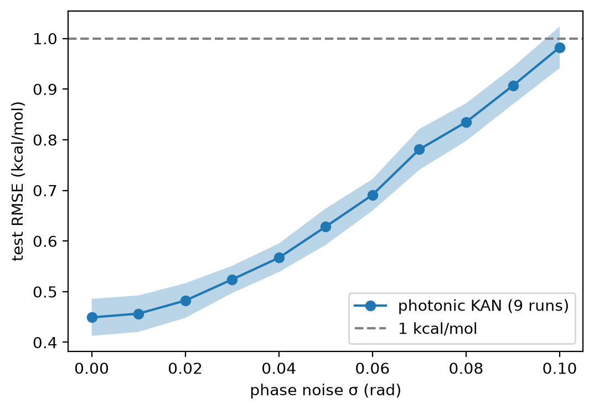
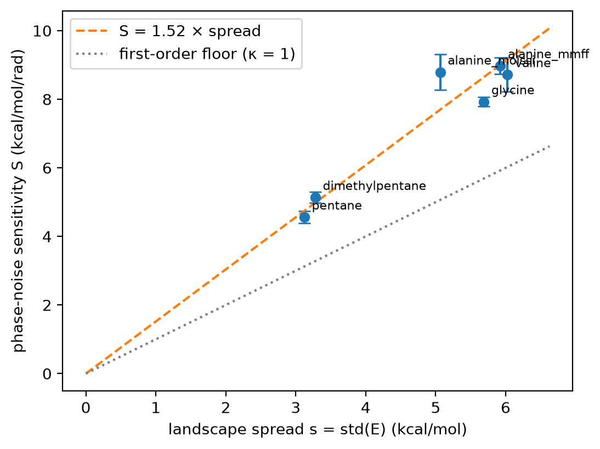

# A phase-noise budget for photonic neural potentials

Photonic processors compute with interference, so their native nonlinearity is a cosine and their main error source is analog phase noise. This repository asks what that means for a concrete chemistry workload: learning molecular torsion energy landscapes E(φ, ψ) with a Kolmogorov–Arnold network built from the same cosine primitive that [Q.ANT's photonic NPU](https://qant.com) exposes in its open-source SDK.

The result is a budget rule. For a trained photonic-native model, phase noise σ adds error in quadrature with a sensitivity proportional to the spread of the energy landscape:

```
RMSE(σ) ≈ √( E₀² + (κ · s · σ)² )        s = std(E) of the landscape,  κ ≈ 1.5

σ_max ≈ √(T² − E₀²) / (κ · s)            largest phase noise that keeps error below a target T
```

Across six landscapes, κ = 1.52 with 8% scatter, and never below the first-order floor κ = 1. For a peptide (s ≈ 6 kcal/mol) at E₀ ≈ 0.45 kcal/mol, staying within 1 kcal/mol needs σ ≲ 0.1 rad, and staying within 10% of clean accuracy needs σ ≲ 0.024 rad (about 1.4°). That turns "will this chip work for this molecule?" into a number a hardware team can check against measured modulator phase stability.

Everything here runs on a laptop CPU. The Q.ANT SDK is used for the parity check only.

## The model

Q.ANT's SDK exposes `calc_kan_layer_fprop`, which computes

```
y_j = Σ_{i,l} tcos(k_l · x_i + φ_jil) · a_jil
```

where `tcos` is the optical cosine-like nonlinearity. `pkan/models.py` implements exactly this layer in PyTorch, so a trained model runs on the SDK unchanged. The network is two layers: 2 inputs (φ, ψ) → 8 hidden channels with 5 integer frequencies → 1 output with 2 frequencies, 201 parameters. The baseline is an MLP of matched accuracy (121 parameters) with (cos, sin) inputs, so both models see the periodicity of the angles.

Two design decisions matter, and both come out of the experiments below. A single KAN layer can only represent f(φ) + g(ψ), so it cannot learn φ–ψ coupling. And stacking cosines multiplies frequencies, so the second layer's frequencies are capped at 2 and high-frequency amplitudes are penalised with λ Σ (k·a)².

## Results

All numbers are mean ± standard deviation over the stated runs. Errors are test-set RMSE in kcal/mol on relative energies. Success criteria were fixed before each experiment.

### 1. Unregularised photonic KANs memorise

On alanine dipeptide (MolSSI data, 324 points), one split, 3 seeds:

| Model | Params | Test RMSE |
|---|---|---|
| KAN, additive (1 layer) | 13 / 25 | 3.85 / 4.19 |
| KAN, 2 layers, unregularised | 77 | 1.80 ± 0.71 |
| KAN, 2 layers, unregularised | 393 | 5.29 ± 0.85 (train 0.000) |
| MLP | 121 | 0.45 ± 0.11 |
| MLP | 369 | 0.26 ± 0.07 |

The additive model plateaus at about 4 kcal/mol, which is the cost of ignoring coupling. Larger two-layer KANs fit the training set exactly and fail between grid points, because composed cosines can oscillate faster than a 20° grid can constrain.

### 2. Capping frequency and penalising it fixes this

λ was chosen per width on a validation carve-out of the training set, and the test set was used once. The 201-parameter model gives 0.442 ± 0.025, a tenfold improvement over an unregularised KAN of similar size. It is still not more parameter-efficient than the MLP, so this repository makes no "fewer parameters" claim.

### 3. Headline comparison, 3 splits × 3 seeds

| | KAN (201) | MLP (121) |
|---|---|---|
| fp32 RMSE | 0.449 ± 0.039 | 0.426 ± 0.076 |
| bfloat16 RMSE | 0.452 ± 0.037 | 0.446 ± 0.072 |
| cost of bfloat16 | **0.003 ± 0.013** | **0.020 ± 0.011** |
| Q.ANT SDK (CPU backend) | 0.455 ± 0.043 | n/a |

Accuracy is at parity. The photonic KAN loses several times less accuracy at the NPU's bfloat16 precision (0.003 against 0.020, about 3 standard errors apart), and its seed-to-seed spread is about half the MLP's. Running it through the SDK reproduces the PyTorch bfloat16 result to within 0.008 kcal/mol on average. On this landscape, the phase-noise sensitivity is 8.79 ± 0.43 kcal/mol/rad, giving σ ≤ 0.024 ± 0.002 rad for ≤10% degradation and σ ≤ 0.102 ± 0.005 rad for ≤1 kcal/mol.



### 4. Noise-aware training helps, but only up to a floor

Training with phase jitter switched on, 3 splits × 2 seeds:

| Training σ (rad) | Clean RMSE | σ at 1 kcal/mol |
|---|---|---|
| 0 | 0.448 ± 0.047 | 0.102 ± 0.006 |
| 0.03 | 0.436 ± 0.038 | 0.110 ± 0.008 |
| 0.06 | 0.452 ± 0.075 | 0.120 ± 0.006 |
| 0.10 | 0.491 ± 0.072 | 0.129 ± 0.009 |

The pre-registered target was a 2× gain in tolerated noise. The measured gain is 1.26×, so the target failed. The reason is structural. To first order, phase noise on a sum of cosines contributes variance σ² Σ aₙ² sin²θₙ ≈ (σ²/2) Σ aₙ², while (by Parseval, for a single layer of orthogonal harmonics) the signal variance is ½ Σ aₙ². The amplitudes that carry the landscape also carry the noise, so the noise RMS is roughly σ · std(E), giving κ ≳ 1. On this landscape (s = 5.06) that caps the achievable gain at about 8.8 / 5.1 ≈ 1.7×. Noise-aware training moved the sensitivity from 8.73 to 6.44 kcal/mol/rad, closing about 63% of the gap to that floor. This is a first-order heuristic, not a theorem for deep models, which is why experiment 5 tests it.

### 5. Sensitivity scales with landscape spread

The locked model was run unchanged on six landscapes, 3 splits × 2 seeds each. Five are MMFF94 relaxed scans generated here; one is the MolSSI dataset.

| Landscape | Spread s | Fourier check | Clean RMSE | Sensitivity S | κ = S/s |
|---|---|---|---|---|---|
| pentane | 3.12 | 0.08 | 0.15 | 4.56 ± 0.17 | 1.46 |
| 2,4-dimethylpentane | 3.28 | 0.29 | 0.42 | 5.13 ± 0.16 | 1.57 |
| alanine (MolSSI) | 5.06 | 0.41 | 0.45 | 8.79 ± 0.51 | 1.74 |
| glycine dipeptide | 5.69 | 0.24 | 0.36 | 7.93 ± 0.14 | 1.39 |
| alanine (MMFF) | 5.92 | 0.16 | 0.35 | 8.98 ± 0.23 | 1.52 |
| valine dipeptide | 6.03 | 0.51 | 0.59 | 8.72 ± 0.50 | 1.45 |

Both pre-registered criteria pass: every κ lies within ±15% of the mean (1.52, coefficient of variation 8%), and every κ ≥ 1. Sensitivity roughly doubles as the spread doubles, from 4.6 to 9.0 against 3.1 to 6.0. The "Fourier check" column is the held-out RMSE of a plain Fourier series fit, used as an independent check that each landscape is smooth enough to learn. `run.py` recomputes it from your own scans.



## Data quality

An earlier version of the MMFF scans relaxed every grid point from a single starting geometry. Many points were trapped in high-energy local minima: pentane topped out at 27 kcal/mol instead of 18, and no smooth model, Fourier series included, could fit those landscapes below 2–4 kcal/mol. The current scans relax each point from five embedded conformers plus its relaxed neighbours, over two sweeps, and keep the lowest energy. That brings the Fourier check to 0.08–0.51 kcal/mol, in line with each landscape's clean model error. The MolSSI scan has its own inconsistency of up to 0.58 kcal/mol between its duplicated ±180° edges, which are removed here.

## What this does not show

The noise model is i.i.d. Gaussian jitter on every cosine argument. Real modulators also drift, have correlated errors and amplitude noise; none of that is tested, and the CPU backend of the SDK is noise-free, so these budgets are simulated, not measured. The six landscapes fall into two spread clusters (about 3.2 and about 5.9 kcal/mol), so the proportionality is tested at two levels rather than across a continuous range. Five of the six landscapes are force-field scans, not quantum chemistry, which is adequate for a test about landscape shape but not for chemical conclusions. κ ≈ 1.5 belongs to this two-layer architecture. Energy per inference, which is the actual case for photonic hardware, was not measured. Finally, real machine-learned potentials use many more coordinates than two torsions.

The obvious next step is to repeat experiment 3 on physical NPU hardware once cloud access is available, replacing the simulated σ with measured phase stability.

## Reproduce

Python 3.12 is required if you want the SDK parity check, because Q.ANT ships its wheels for 3.12 only. Everything else works on any recent Python.

```bash
python -m venv .venv && source .venv/bin/activate        # Windows: .venv\Scripts\activate
pip install torch --index-url https://download.pytorch.org/whl/cpu
pip install -r requirements.txt
```

For the optional SDK, download `qant-native-computing-toolkit-wheels-cpu-backend-v2.3.1.zip` from the [toolkit releases](https://github.com/Q-ANT-GmbH/qant_native_computing_toolkit/releases), unzip it, and `pip install` the wheel for your platform.

```bash
python run.py --quick        # ~3 min smoke test of every code path (numbers not meaningful)
python run.py                # full run, ~30-45 min; prints every table above
python run.py --exp spread   # a single experiment
pytest                       # unit tests (SDK parity test skips if the SDK is absent)
```

Energy landscapes are cached in `data/` on first use (the MMFF scans take about a minute each). Tables are written as CSV to `results/`, figures to `results/figures/`. Re-runs reproduce the numbers above to within run-to-run noise. Small differences in the MMFF scans across RDKit versions and platforms (≤0.1 kcal/mol in spread) are expected.

## Layout

```
run.py              entry point: runs, prints and saves all experiments
pkan/config.py      locked hyperparameters (full and --quick presets)
pkan/data.py        MolSSI loader, MMFF multi-start relaxed scans, Fourier data-quality check
pkan/models.py      photonic KAN layer (= calc_kan_layer_fprop), MLP, phase-noise context
pkan/train.py       training, evaluation, sensitivity fit and noise budget
pkan/sdk.py         Q.ANT SDK inference path (optional)
pkan/experiments.py the five experiments
pkan/plots.py       figures
tests/              unit tests
```

## Sources

Alanine dipeptide reference scan from the [MolSSI Education](https://github.com/MolSSI-Education/python-visualization) Python visualization materials. MMFF94 scans computed with [RDKit](https://www.rdkit.org). KAN formulation follows Liu et al., [KAN: Kolmogorov–Arnold Networks](https://arxiv.org/abs/2404.19756), in the periodic form implemented by the [Q.ANT native computing toolkit](https://github.com/Q-ANT-GmbH/qant_native_computing_toolkit) (Apache-2.0). This is an independent project and is not affiliated with or endorsed by Q.ANT.

## Authorship

Code written with AI assistance; experimental design, analysis and debugging are my own.
